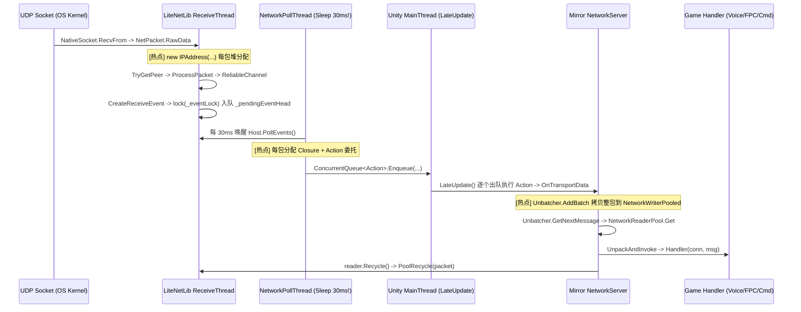
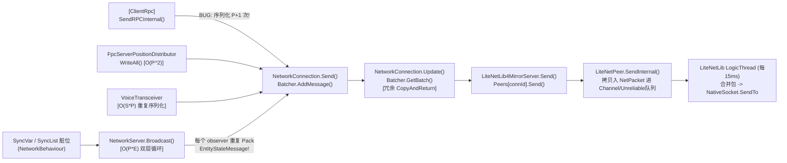

# SCP:SL 原生服务端线程模型、调用链路与架构分析（ARCHITECTURE.md）

> 基于 SCP:SL `14.2.9` (`Assembly-CSharp.dll` + `Mirror.dll` + `Assembly-CSharp-firstpass.dll` + `LabApi.dll`) 静态反编译分析绘制。

---

## 1. 服务端线程模型全景

| 线程名 / 来源 | 所在程序集与入口 | 运行模式 / 唤醒机制 | 职责 | 跨线程同步机制 | 已知问题 |
| --- | --- | --- | --- | --- | --- |
| **Unity Main Thread** | `UnityPlayer.dll` → `PlayerLoop` | 60Hz (`Application.targetFrameRate = 60`) | 全部 MonoBehaviour 回调、`Mirror.NetworkLoop`、`StaticUnityMethods`、`MEC.Timing`、PhysX 步进、LabAPI 事件 | 主线程单线程所有权 | 承担几乎 100% 游戏逻辑、同步序列化、广播循环与物理查询 |
| **`ReceiveThread(<port>)`** | `Assembly-CSharp.dll` → `LiteNetManager.NativeReceiveLogic` / `ReceiveLogic` | 阻塞/轮询 `Socket.Select` (`ReceivePollingTime = 50000µs`) + `NativeSocket.RecvFrom` | 接收 UDP 报文、校验头、A2S 响应、重组分片、`ReliableChannel.ProcessPacket`、推入 `_pendingEventHead` | `ReaderWriterLockSlim _peersLock`、`lock(_eventLock)`、`lock(_poolLock)`、`lock(_outgoingAcks)` | 每收包分配 `new IPAddress`；与发送/逻辑线程竞争 `_poolLock` |
| **`LogicThread`** | `Assembly-CSharp.dll` → `LiteNetManager.UpdateLogic` | `AutoResetEvent.WaitOne(UpdateTime)` (`UpdateTime = 15ms`) | 遍历 `_headPeer` 执行 `peer.Update()`：发送 Ping、MTU 探测、ACK、重传可靠包、刷出 `_unreliableChannel` 与 `_mergeData` | `lock(_unreliableChannelLock)`、`lock(_pendingPackets)`、`lock(OutgoingQueue)`、`_peersLock` | `SendInternal` 由主线程入队，实际 `SendRawCore` 延迟最多 15ms 在此线程发出（或可 `TriggerUpdate()`） |
| **`NetworkPollThread`** | `Assembly-CSharp.dll` → `LiteNetLib4MirrorTransport.PollingLoop` | **`Thread.Sleep(30)` 硬休眠循环** | 调用 `Host.PollEvents()`，将事件包装为闭包 `Action` 入队至 `ConcurrentQueue<Action> Events` | `lock(_eventLock)` + `ConcurrentQueue<Action>` | **冗余中转线程**：引入 0–30ms 脉冲抖动 + 每包 2 次堆分配（闭包 + Action） |
| **`ConnectionRequestThread`** | `Assembly-CSharp.dll` → `LiteNetLib4MirrorServer.ConnectionRequestLoop` | `Thread.Sleep(30)` 轮询 `_connectionRequests` | 预鉴权挑战、封禁查询、ECDSA 公钥验签、触发 `PlayerEvents.OnPreAuthenticating` | `ConcurrentQueue<ConnectionRequest>` + `ConcurrentDictionary`（`UserIds`/`Challenges`/限流表） | `Thread.Sleep(30)` 引入小幅建连延迟；**注意**：`PlayerEvents.OnPreAuthenticating` 在此后台线程触发！ |
| **`ServerConsole` 后台线程组** | `Assembly-CSharp.dll` → `ServerConsole` | 多条独立 `Thread`（进程监控、公钥刷新、中心服心跳/列表验证） | 与 Northwood Central Server HTTP 通信、监控 LocalAdmin 进程 | `ConcurrentBag` / `ConcurrentQueue` / `ConcurrentDictionary` | 低频后台 IO，严禁触碰官方通信与认证 |
| **`QueryServer` / `ServerLogs` / `ServerOutput`** | `Assembly-CSharp.dll` | 独立 IO 线程 | TCP 控制台 (`TcpConsole`)、文件日志写入 (`FileConsole`/`ServerLogs`)、Query 协议 | 线程安全队列 | 仅在日志风暴时产生队列压力 |
| **`MemoryCleaner` 临时线程** | `Assembly-CSharp.dll` → `MemoryCleaner.CleanupMemory` | 每次 `SceneManager.sceneLoaded` 新建后台线程 | 执行 `LOH CompactOnce` + 2× `GC.Collect()` + `WaitForPendingFinalizers()` | 无同步协调 | 仅在切场景时运行 |
| **Unity Native Job/PhysX Workers** | `UnityPlayer.dll` | Unity 原生工作线程池 | PhysX 内部求解、JobSystem (`IJobParallelFor` / `Physics.*Command.ScheduleBatch`) | Unity 原生 JobHandle | 原版游戏逻辑 **0% 使用** |

---

## 2. 单帧主循环完整执行链路（Unity PlayerLoop）

```mermaid
flowchart TD
    A["Unity Frame Start (60 Hz target = 16.67ms)"] --> B["EarlyUpdate"]
    B --> B1["Mirror.NetworkLoop.NetworkEarlyUpdate()"]
    B1 --> B2["NetworkServer.NetworkEarlyUpdate()<br/>- Transport.ServerEarlyUpdate() (LiteNetLib4Mirror为空)<br/>- connections.UpdateTimeInterpolation()"]
    B2 --> C["FixedUpdate (50 Hz PhysX 步进)"]
    C --> C1["PhysX 刚体/碰撞模拟"]
    C1 --> C2["21 个 FixedUpdate() MonoBehaviour:<br/>- FirstPersonMovementModule.FixedUpdate (Tracer.Record)<br/>- TeslaGateController.FixedUpdate (门×全玩家扫描)<br/>- CustomNetworkManager.FixedUpdate (限流/挑战表清理)<br/>- MainThreadDispatcher.FixedUpdate<br/>- StaticUnityMethods.FixedUpdate (0订阅)"]
    C2 --> D["Update (60 Hz 主逻辑)"]
    D --> D1["StaticUnityMethods.Update() -> OnUpdate (32类+数百Pickup实例)<br/>- FirstPersonMovementModule._activeUpdates (全玩家移动/SphereCast/RelativePos)<br/>- PickupStandardPhysics.OnUpdate (每拾取物1次委托调用+Rb.IsSleeping)<br/>- WaveManager / AFKManager / UsableItems / DisarmedPlayers"]
    D1 --> D2["346 种 MonoBehaviour.Update():<br/>- StatusEffectBase.Update (每玩家50-80+组件!)<br/>- CurrentRoomPlayerCache.Update (多格房间触发Raycast)<br/>- Inventory.Update (UpdateObserverItems + RefreshModifiers)<br/>- PlayerStats.Update (Health/Ahp/Stamina/HumeShield/Vigor)<br/>- AnimatedCharacterModel.Update (骨骼/脚步)<br/>- Scp173ObserversTracker / Scp096TargetsTracker<br/>- EnvironmentalHazard.Update (每毒气/呕吐物×全玩家)<br/>- DoorVariant.Update / ElevatorChamber.Update<br/>- MEC.Timing.Update (协程调度)"]
    D2 --> E["PreLateUpdate / LateUpdate"]
    E --> E1["LiteNetLib4MirrorTransport.LateUpdate()<br/>排空 Events 队列 -> OnServerDataReceived<br/>-> NetworkServer.OnTransportData -> Unbatcher -> MessageHandlers<br/>(FpcFromClient, VoiceTransceiver, Commands, RPCs)"]
    E1 --> E2["StaticUnityMethods.LateUpdate() -> OnLateUpdate<br/>- FpcServerPositionDistributor.LateUpdate() [O(P^2)核心热点]"]
    E2 --> E3["76 种 MonoBehaviour.LateUpdate():<br/>- AdminToyBase.LateUpdate (大地图数千Toy)<br/>- CullingSubcontroller.LateUpdate (Animator.Update)<br/>- SubroutineBase.LateUpdate (全SCP子程序)"]
    E3 --> E4["Mirror.NetworkLoop.NetworkLateUpdate() [PreLateUpdate尾部]<br/>-> NetworkServer.NetworkLateUpdate()<br/>-> AccurateInterval -> NetworkServer.Broadcast() [O(P*E)核心热点]<br/>-> conn.Update() (Batcher.GetBatch -> SendToTransport -> LiteNetPeer.Send)"]
    E4 --> F["Incremental GC Slice (gc-max-time-slice=3ms) & Frame Sleep"]
```



> **架构级关键观察（执行顺序细节）**：
> 1. `Mirror.NetworkLoop.NetworkLateUpdate` 注入在 `PreLateUpdate` 尾部；而 MonoBehaviour 的 `LateUpdate()` 在 `PreLateUpdate.ScriptRunBehaviourLateUpdate` 执行——因此在同一帧内，`LiteNetLib4MirrorTransport.LateUpdate()`（消费收到的客户端包）与 `FpcServerPositionDistributor.LateUpdate()`（将最新位置写入各连接 Batcher）均**先于** `NetworkServer.NetworkLateUpdate()`（刷出 `EntityStateMessage` 与所有连接的 `Batcher` 缓冲区）执行！
> 2. 任何对网络收包时机的优化都必须尊重这一先后关系（确保本帧 `FpcServerPositionDistributor` 与游戏 `Update` 所产生的消息在同一帧的 `NetworkServer.Broadcast()` 尾部 `conn.Update()` 中被一次性刷入 LiteNetLib）。

---

## 3. 网络报文全链路（收包与发包）

### 3.1 收包链路（UDP Socket → 游戏处理器）



### 3.2 发包链路（状态变更 / FPC / Voice / RPC → UDP Socket）



---

## 4. `SLPerformance` 插件工程架构设计（面向第四至六阶段）

遵循“**性能优先、正确性为前提、零多余抽象层、模块化可独立开关与 A/B 压测**”原则：

```text
projects/SLPerformance/
├── RESEARCH.md                     # 本研究总报告
├── ARCHITECTURE.md                 # 线程模型、调用链路与架构设计
├── HOTSPOTS.md                     # 性能热点与静态/动态证据清单
├── OPTIMIZATIONS.md                # 候选优化方案与优先级矩阵
├── COMPATIBILITY.md                # 运行时、游戏版本与插件兼容性说明
├── BENCHMARKS.md                   # 压测方法与真实测试数据记录
├── PROGRESS.md                     # 阶段进度与未解决问题追踪
└── src/                            # （第四阶段起构建）
    ├── SLPerformance/              # 独立 LabAPI 优化插件主工程
    │   ├── Core/                   # Plugin 入口、配置、模块注册与运行时开关
    │   ├── Patching/               # Harmony 补丁管理器、按模块隔离/回滚、冲突检测
    │   ├── Profiler/               # 低开销主线程帧耗时分位统计、方法采样器、GC/包频监控
    │   ├── Diagnostics/            # 控制台诊断命令 (slperf stats/profile/toggle/verify)
    │   ├── Network/                # Mirror Broadcast、SendRPCInternal、Batcher/Unbatcher、Transport、Voice
    │   ├── Serialization/          # FPC 帧快照预计算、零冗余缓冲复用
    │   ├── Entities/               # Effect 索引缓存、StatusEffect 休眠、AdminToy、Pickup、Hazard、Room 缓存
    │   ├── Physics/                # FpcMotor 静止短路、VisionInformation 短路、SCP-096/173 裁剪、批处理实验
    │   ├── Memory/                 # LabAPI 零分配事件分发、EventArgs 延迟构造、OpusDecoder 懒加载、泄漏修复
    │   ├── Collections/            # 紧凑数组、零分配索引结构、固定槽位映射
    │   ├── Threading/              # 受控后台预处理（仅在实测收益 > 同步开销时启用）
    │   └── Compatibility/          # 版本指纹校验、安全降级守卫、第三方插件钩子兼容检测
    ├── SLPerformance.Tests/        # 行为等价性单元测试与序列化字节级回归测试
    └── SLPerformance.Benchmarks/   # 独立微基准测试（纯算法/序列化/数据结构对照）
```

### 关键架构设计原则

1. **零虚调用热路径**：所有优化模块仅在初始化阶段通过配置注册 Harmony Prefix/Postfix/Transpiler；热路径内部使用静态字段、结构体数组与内联方法，**不引入 DI 容器、事件总线中间件或接口抽象链**。
2. **故障隔离与动态开关**：每个优化项对应唯一 `ModuleId`（例如 `net.mirror_broadcast`、`net.fpc_distributor`、`net.transport_direct_poll`），配置支持独立 `Enabled`；任何 Harmony 补丁校验失败时仅禁用该模块并输出精确诊断，不拖垮其他模块或服务端。
3. **验证先于优化**：第四阶段先交付 `Core + Patching + Profiler + Diagnostics`，在真实服/模拟负载下验证静态热点假设并建立基准线，再逐项合入第五阶段优化并跑第六阶段对照实验。
